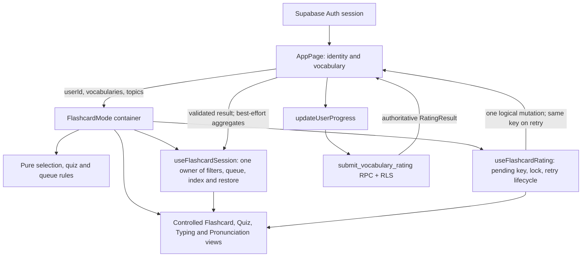

# EasyTOEIC Flashcard Phase C2 — Architecture Design

**Status:** Draft for product/engineering review. Investigation and planning only; no application refactor is authorized by this document.

**Baseline:** `ca8c096413a6292324ea1c09bf2664f38d76467d` (Phase C1), whose parent is Phase B `5f9a279dbe33d7276b75a627e0ec0ba46154844c`.

## Goal and constraints

Make the Flashcard learning module easier to reason about, test, and extend through small extractions with explicit ownership boundaries. The work must preserve all current rendered UI, four-mode behavior, accessibility, session recovery, server-authoritative SRS, idempotent retry, Auth request counts, account isolation, and Phase C1 loading behavior. It must not add features, change database code, or claim performance gains from file splitting.

The full-suite comparison point is Phase C1: 486 passed, six established failures, and one build-dependent bundle test skipped by default. The six identities are the five `progressService` assertions (TEST 4, 5, 6, 7, 9) and `appDataService.test.ts` “still rejects when core data fails”. The latter assertion conflicts with the approved concurrent aggregate/core loading contract and must remain visible as a known baseline discrepancy.

## Verified current architecture

### Responsibilities and ownership

| Layer | Current owner | Verified responsibility |
|---|---|---|
| Auth and app data | `app/app/page.tsx` (`AppPage`) | Owns authenticated user identity, C1 core/aggregate request lifecycles and stale-response guards; passes vocabulary, topics, user ID and callbacks to the study component. |
| Mutation boundary | `AppPage.handleUpdateProgress` → `services/vocabService.updateUserProgress` → `services/progressService.submitVocabularyRating` | Makes one RPC through the authenticated Supabase client, applies only the returned `RatingResult`, ignores late results after identity changes, then refreshes aggregates best-effort. `userId` is not server authorization; the JWT/RPC/RLS boundary remains authoritative. |
| Study state and interaction | `components/FlashcardMode.tsx` (`FlashcardSession`) | Owns topic/status filters, queue/index, restore state, completion stats, four exercise modes, answer state, rating lock/pending action, keyboard listeners, pronunciation recognition, audio, animation and modal state. The file is 2,479 lines. `FlashcardMode` keys the inner session by `userId`, remounting it on account changes. |
| Existing pure/domain helpers | `lib/session/*`, `lib/srs/*`, `lib/quiz/*`, `lib/pronunciation/evaluatePronunciation.ts` | Queue reinsert/transition, session and pending-action storage, authoritative result reconciliation, schedule reference, seeded shuffle, normalized unique quiz labels and pronunciation transcript evaluation. Keep these contracts as the foundation; do not duplicate them in a hook. |
| Other Quiz component | `components/QuizMode.tsx` | A separate standalone quiz component. Repository search found no import/call site. It is not one of the four embedded Flashcard submodes and is outside C2 unless a separate usage audit changes that fact. |

The four embedded modes are conditional views inside `FlashcardSession`; there are no dedicated Typing or Pronunciation components/hooks. The code also contains a separate `QuizMode.tsx`, which must not be conflated with the embedded Quiz submode.

### Current flow and proposed ownership

The diagram describes a proposed boundary, not a committed implementation. There must be one canonical owner for each state field: session hook owns queue/index/filter/completion; rating hook owns submission lock and pending action; the container owns only cross-mode UI, keyboard routing, stable DOM refs, and any mode-local state not yet extracted. Mode views receive values and callbacks and do not write session storage, call Supabase, schedule SRS, or own a second copy of session state.

## Findings and maintainability risks

1. **Mixed responsibilities:** one component combines durable session orchestration, mutation recovery, four exercise-specific state machines, browser APIs, animation, sound and a large amount of presentation. A change to a small view currently requires loading and testing the entire module.
2. **State reset coupling:** a mode/index effect queues resets for flashcard reveal, typing answer, quiz answer, pronunciation callbacks and transcript. Topic/status changes reset queue, mode, completion and stats through another effect. Extractions must preserve when resets happen, including the current asynchronous microtask behavior.
3. **Queue and persistence coupling:** queue transition is pure and already isolated, but `handleRating` also owns a synchronous duplicate-submit lock, idempotency key, pending storage, RPC callback, stale-current-card check, queue commit, session snapshot, completion UI, and pending-action cleanup. Splitting it without a success/failure state table could lose a confirmed result or duplicate a review log.
4. **Cross-layer identity:** `AppPage` is the persistence boundary while `FlashcardSession` supplies the key and current user scope for retry storage. The inner key-by-user remount and parent identity-generation guards complement one another; neither can be removed as “redundant”.
5. **Mode-state coupling:** keyboard handling dispatches to exercise handlers; rating/reveal controls are shared outside the mode blocks. Quiz correctness uses active filtered vocabulary; Typing owns Enter behavior; Pronunciation uses callback attempt IDs to reject stale browser events. Presentation extraction must leave these interaction contracts intact.
6. **Coverage concentration and gaps:** `FlashcardMode.test.tsx` covers keyboard guards, quiz labels, Auth request counts, retries, rapid submission locking and some session recovery, but concentrates many contracts in one component test. `queueTransition.ts` and `lib/session/storage.ts` have no dedicated test files in the current tree. `page.rating.test.tsx` covers account switching and late parent mutations. Scheduler and authoritative patch functions have independent tests. No dedicated embedded mode view tests exist because those views are inline.
7. **Performance is not a C2 success metric:** Phase C1 browser profiling did not isolate a Flashcard hot path; its component was unchanged. Historical CPU figures are noisy and CPU-only. Refactoring may add props or render boundaries and can regress bundle/render behavior. C2 must compare a fresh baseline with the same harness and report no gain unless measurements support one.

No confirmed behavior bug is being asserted here. These are coupling and testability risks inferred from current source structure.

## Design alternatives considered

1. **Split the JSX into files only.** Fast and low state risk, but it leaves session restore and retry semantics tangled in the original component and makes the new components receive a broad, poorly defined prop surface.
2. **Replace the full component with a reducer/state machine and four independent feature modules.** Strong theoretical boundaries, but it rewrites many timing-sensitive state transitions at once, creates a large compatibility surface, and is not justified by measured performance or a current behavior defect.
3. **Recommended: characterization-first, pure helpers first, then one owner-preserving session hook, a narrowly scoped rating lifecycle hook, and controlled view extraction one mode at a time.** Keep AppPage, RPC/service contracts, existing pure helpers, DOM markup/classes and browser APIs in their current locations until tests prove a narrower safe boundary. Stop an extraction if it needs duplicated state, changes event timing, or causes noisy UI diffs.

## Proposed module boundaries

| Proposed module | Single responsibility | Must not own |
|---|---|---|
| `lib/session/activeVocabulary.ts` | Deterministically select/order active vocabulary for topic/status and a supplied `nowMs`. Preserve current filtering and sort rules. | React state, storage, network, current wall clock. |
| `lib/session/restoreStudySession.ts` | Validate a loaded snapshot against user/filter/context and available IDs; produce a queue/index decision or “no usable snapshot”. | Reading/writing storage, user authentication, React state. |
| `lib/quiz/flashcardOptions.ts` | Build the embedded Flashcard quiz choices and correct index from current vocabulary and active vocabulary, preserving normalization and seed strings. | UI, random global state, session mutation. |
| `hooks/useFlashcardSession.ts` | Sole owner of filter, queue, index, restore, session completion/stats, restart and successful-rating queue/snapshot commit. | RPC calls, a duplicate rating queue, audio, DOM, Auth lookup. |
| `hooks/useFlashcardRating.ts` | Sole owner of pending-action lifecycle, sync submission lock, same-key retry and “server action confirmed” callback. | SRS calculation, direct Supabase client construction, a second session queue. It calls the existing `onUpdateProgress` boundary. |
| `components/flashcard/FlashcardExercise.tsx` | Controlled rendering for the card face/back and reveal actions. | Session storage or progress mutation. |
| `components/flashcard/QuizExercise.tsx` | Controlled rendering for embedded multiple choice. | Choice generation, queue mutation or RPC. |
| `components/flashcard/TypingExercise.tsx` | Controlled typing input/feedback view; receives Enter action and result. | Global keyboard listener or rating persistence. |
| `components/flashcard/PronunciationExercise.tsx` | Controlled pronunciation UI only. | `SpeechRecognition` construction/lifecycle or permission requests in this phase. |
| `components/FlashcardMode.tsx` | Composition/container, shared keyboard policy, dialog/settings shell, animation/audio DOM refs and wiring. | A competing copy of hook-owned session or rating state. |

All new boundaries are proposals. If controlled views need a broad generic “mode framework”, keep the JSX inline and report that extraction as unnecessary. Do not move `AppPage`, `services/vocabService.ts`, `services/progressService.ts`, database code, `components/QuizMode.tsx`, or pronunciation browser lifecycle as part of the initial C2 sequence.

## Preservation invariants

- Keep rating values and mapping (`again`, `hard`, `good`, `easy`, `mastered`) unchanged. Scheduling remains server-authoritative in `submit_vocabulary_rating`.
- A successful logical action invokes the RPC once; transport retry reuses the same idempotency key. The client applies the validated RPC result and never computes a competing schedule.
- Again keeps the existing queue gap and duplicate handling. Queue advance and `sessionStorage` snapshot happen only after server confirmation. Aggregate refresh cannot roll back a rating.
- Keep the Phase B zero-Auth-request rating path: no `auth.getUser()`/`/auth/v1/user` preflight is added.
- Preserve pending-action status/recovery, confirmed-action recovery, session snapshot format/version, completion clearing, and per-user keys.
- Preserve the component key by user ID, AppPage identity-generation guard, unmount guard, current-vocabulary guard, and real RLS/JWT authorization.
- Keep native Tab/Shift+Tab, Enter handling, focus guards, composition/repeat/modifier guards, quiz digit shortcuts, mode cycling, dialogs and button actions unchanged.
- Preserve current quiz seeds/choice normalization, empty/invalid inputs and insufficient alternatives. Preserve current mode-specific answer and score behavior.
- Preserve microphone permission and recognition timing, cancellation attempt IDs, unsupported/error states, browser audio, reduced-motion behavior, markup, Tailwind classes and responsive output.
- Preserve C1 `loadAppCoreData` and aggregate concurrency/error isolation, Dashboard unknown-value placeholders, and collection statistics output. No C1 page/service changes are planned.

## Out of scope

Any new user-facing behavior; SRS formula, rating labels or RPC/service semantics; Supabase schema/RLS/RPC/migrations/data; Phase 1; Phase C1 app-data changes; standalone `QuizMode.tsx`; microphone permissions/recognition behavior; Excel/CSV loading; redesign, accessibility behavior changes, global state library, new dependency, speculative memoization or performance refactor, routing changes, commits, push, merge or deployment.

## Baseline and production evidence

- Fresh Git inspection found local `main`, `origin/main` and `HEAD` all at C1 `ca8c096413a6292324ea1c09bf2664f38d76467d`. The C1 branch/worktree is also at that SHA. Existing C: synonym and Phase 1 worktrees remain untouched. The Phase 1 commit is not an ancestor of current main.
- C1 is therefore the exact source baseline. Latest GitHub commit status for this SHA reports Vercel `success`, “Deployment has completed”, deployment record `GfbULLijYQTcBRiyJwEi4z3hXqEo`. The user has confirmed Production Branch `main`; prior authenticated evidence linked `study-toeic` to this repository. This supports that Vercel completed the main deployment. The intended Production domain and authenticated post-deployment smoke were not verified in this audit; do not claim those checks passed.
- The main checkout currently contains pre-existing untracked `AGENTS.md` and `docs/plans/`. They were inspected only for names and left untouched. Planning files are written in the dedicated E: plan worktree so local `main` remains unchanged.
- E: had over 240 GB free before the plan worktree was created. No dependencies, caches, build output, screenshots or browser profiles were generated for this planning task.

## Approval boundary

This design and its companion plan are drafts for review. No production code is changed. Human approval of the architecture/plan is required before C2 implementation starts; if approval narrows a module boundary, revise the plan first.
